<div align="center">

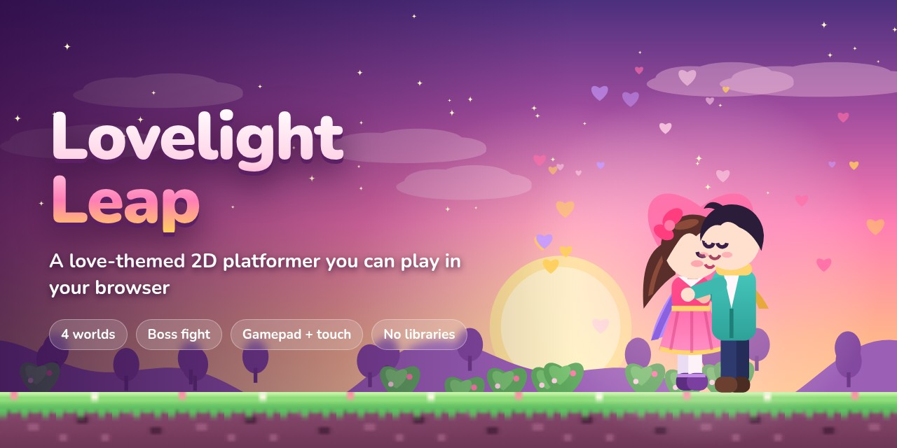

# 💖 Lovelight Leap

**A love-themed 2D platformer you can play in your browser.**
Run, jump and bounce through four hand-built worlds, cheer up grumpy creatures, collect love letters, and win back a stormy cloud king so Amara can finally meet Theo under the moon.

[](https://rishabh-bgp.github.io/lovelight-leap/)


**[Play now →](https://rishabh-bgp.github.io/lovelight-leap/)**

</div>

---

## 🌅 The story

Amara and Theo promised to meet at the **Moonlit Castle** when the stars came out. But a gloomy storm has made the whole kingdom grumpy, and the path is full of sulky creatures.

Amara leaps through the Rose Garden, the Candy-Cloud Sky and the Starry Night City. She cheers up everyone she meets with a hop or a heart arrow, and she gathers the love letters Theo left along the way. At the castle she meets **King Grumblecloud**, the storm cloud behind it all. You don't defeat him: you fill his mood meter with heart arrows until he smiles, the rain stops, and the heart gate opens for the reunion.

No violence, nothing scary: grumpy creatures float away happy when you hop on them.

## ✨ Features

| | |
|---|---|
| 🎮 **Tight platforming** | Fixed 60 updates per second, coyote time, jump buffering, variable jump height, one-way ledges, love springs and stomp combos |
| 🗺️ **4 themed worlds** | Garden, sky, city and castle, each with its own tiles, parallax layers, ambient effects and music key |
| 💌 **Things to find** | Hearts (100 = extra life), 3 hidden love letters per world, and 2 power-ups |
| 🏹 **Power-ups** | **Cupid's Bow** shoots heart arrows, aimable upward. **Sparkle Shield** keeps you safe for 8 seconds |
| 🐾 **Original creatures** | thorny bramble critters, grumpy storm clouds that rain on you, and broken-heart bats |
| ☁️ **A boss you cheer up** | King Grumblecloud hovers, dives and sweeps, and drops raindrops. Fill his mood meter instead of his health bar |
| 🏮 **Checkpoints** | Heart lanterns save your place mid-world |
| ⭐ **Stars and saves** | Earn up to 3 stars per world: finish, find all letters, beat the par time. Progress, best scores and settings live in `localStorage` |
| 🎬 **Cinematic ending** | The camera zooms in on a hug and a heart burst at the castle gate |
| 🎵 **Original chiptune** | Three songs and every sound effect are synthesised live with the Web Audio API. Music and sound toggle separately |
| 📱 **Plays everywhere** | Keyboard, gamepad and touch buttons on phones. Crisp pixel scaling up to 4× on any screen, portrait and landscape |
| ♿ **Considerate** | Respects `prefers-reduced-motion` (no screen shake, fade transitions), keyboard-usable menus and WCAG 2.1 AA checks with axe |
| 🎨 **Zero assets** | Every character, tile, background and particle is drawn in code. No images, fonts, libraries or build step |

## 🕹️ Controls

| Action | Keyboard | Gamepad | Touch |
|---|---|---|---|
| Move | `←` `→` or `A` `D` | D-pad / left stick | ◀ ▶ buttons |
| Jump (hold to go higher) | `Space`, `Z`, `↑` or `W` | A / B | 💗 button |
| Heart arrow (with the bow) | `X` (hold `↑` to aim up) | X / Y (hold up to aim up) | 🏹 button |
| Drop through a thin ledge | `↓` + jump | Down + A | — |
| Pause | `P` or `Esc` | Start | ❚❚ button |
| Mute | `M` | — | Sound toggle |

## 🗺️ Worlds

| # | World | What's there | Par |
|---|---|---|---|
| 1 | 🌹 **Rose Garden at Sunset** | Gentle hills, rose bushes, thorn patches and your first bramble critters | 1:30 |
| 2 | 🍭 **Candy-Cloud Sky** | Floating islands, love springs and grumpy storm clouds that rain on you | 1:40 |
| 3 | 🌃 **Starry Night City** | Rooftop runs, street lamps and flapping broken-heart bats | 1:50 |
| 4 | 🏰 **Moonlit Castle** | Candlelit halls, a locked arena and King Grumblecloud | 2:30 |

## 📸 Screenshots

| Title screen | World select |
|---|---|
| 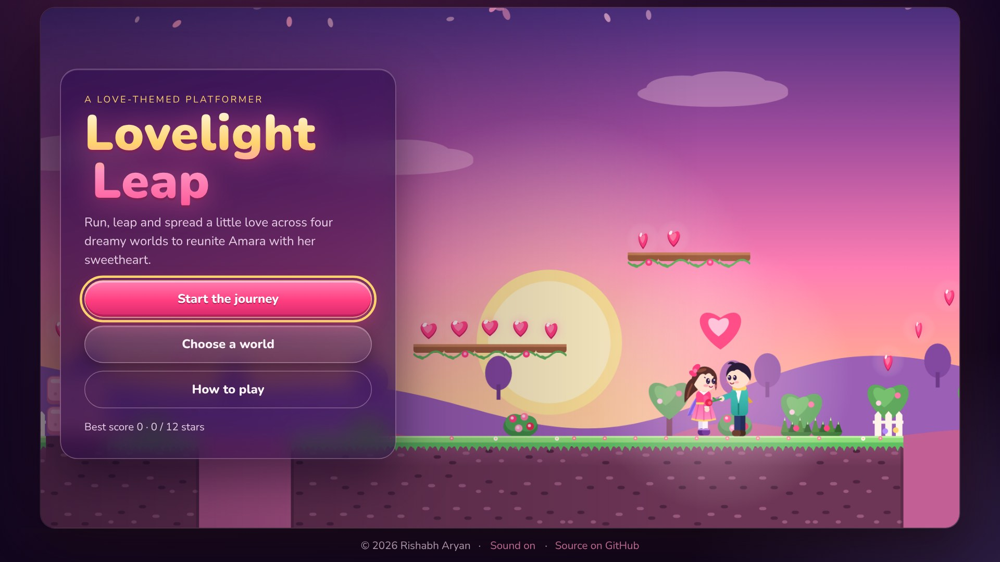 | 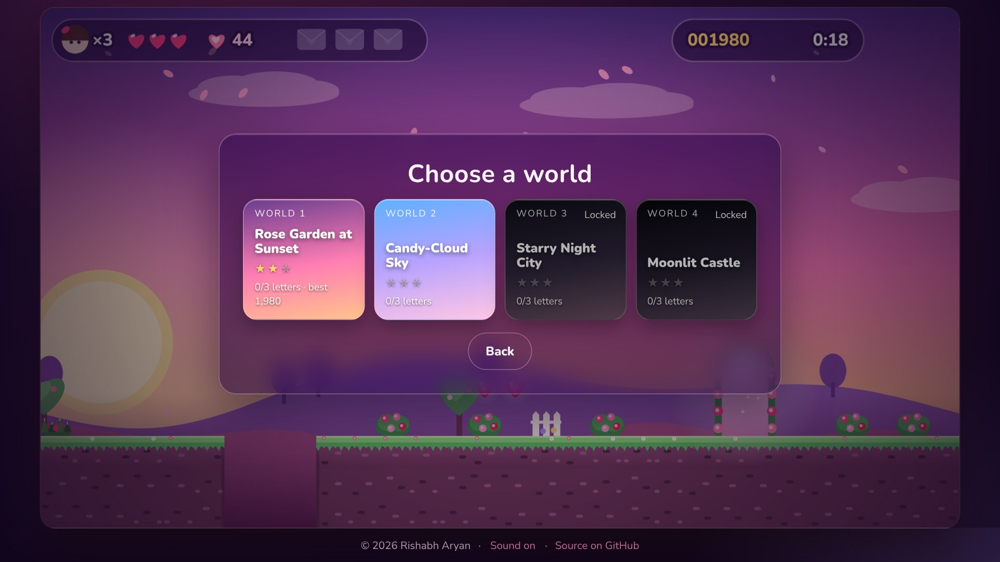 |

| World 1: Rose Garden | World 2: Candy-Cloud Sky |
|---|---|
| 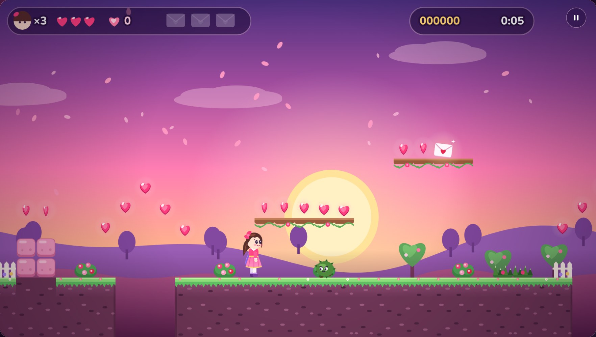 | 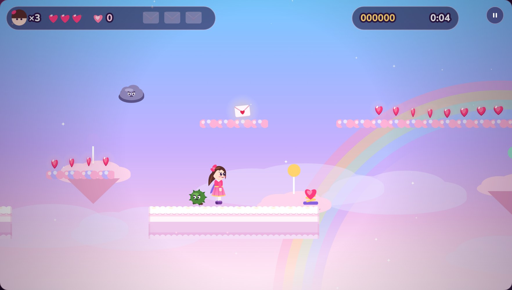 |

| World 3: Starry Night City | World 4: Moonlit Castle |
|---|---|
| 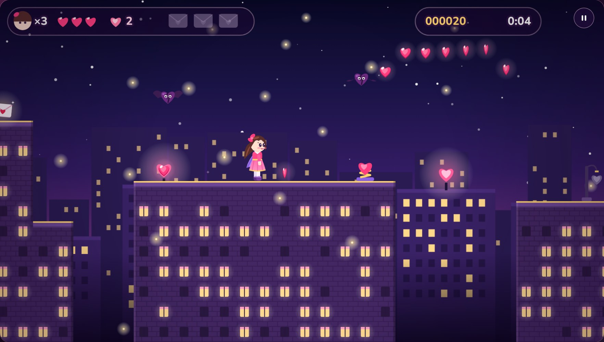 | 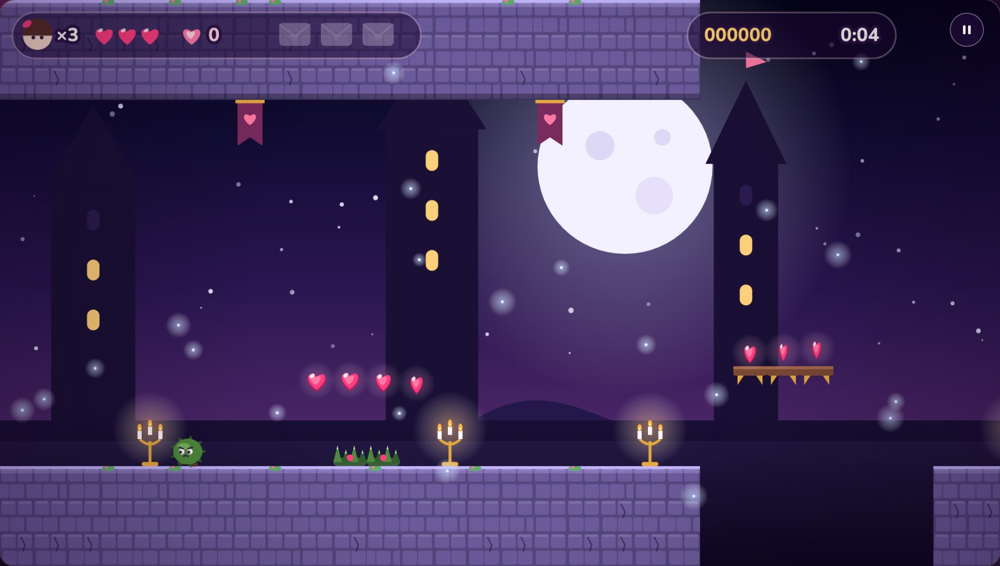 |

| Cupid's Bow power-up | Boss: King Grumblecloud |
|---|---|
| 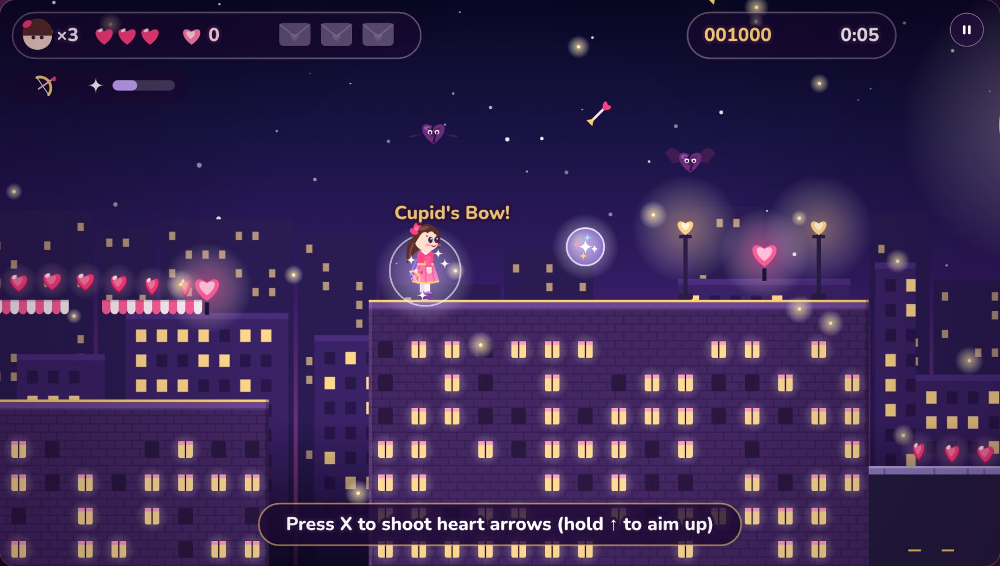 | 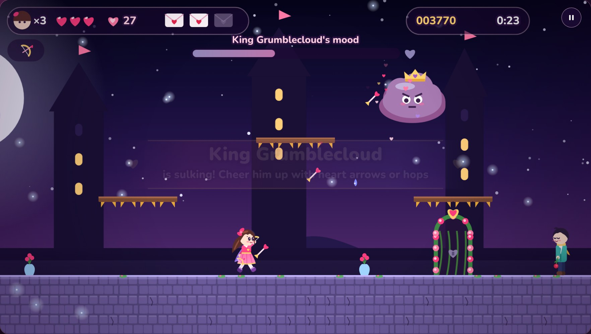 |

| Reunion | The end |
|---|---|
| 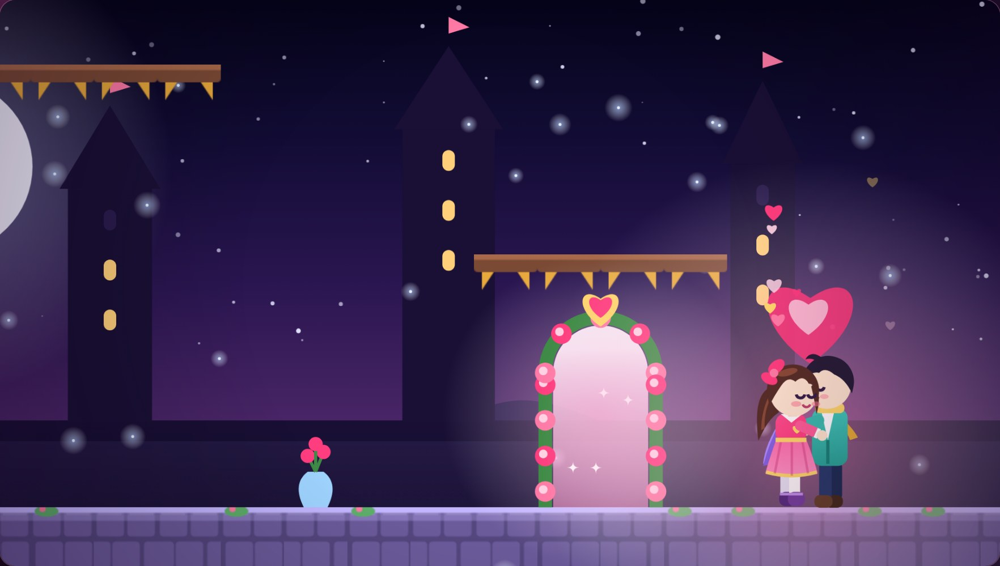 | 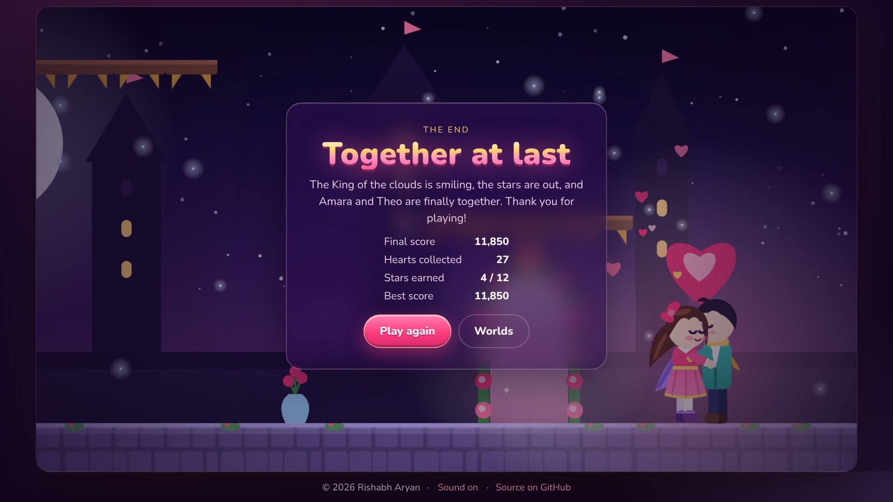 |

| World clear with stars | How to play |
|---|---|
| 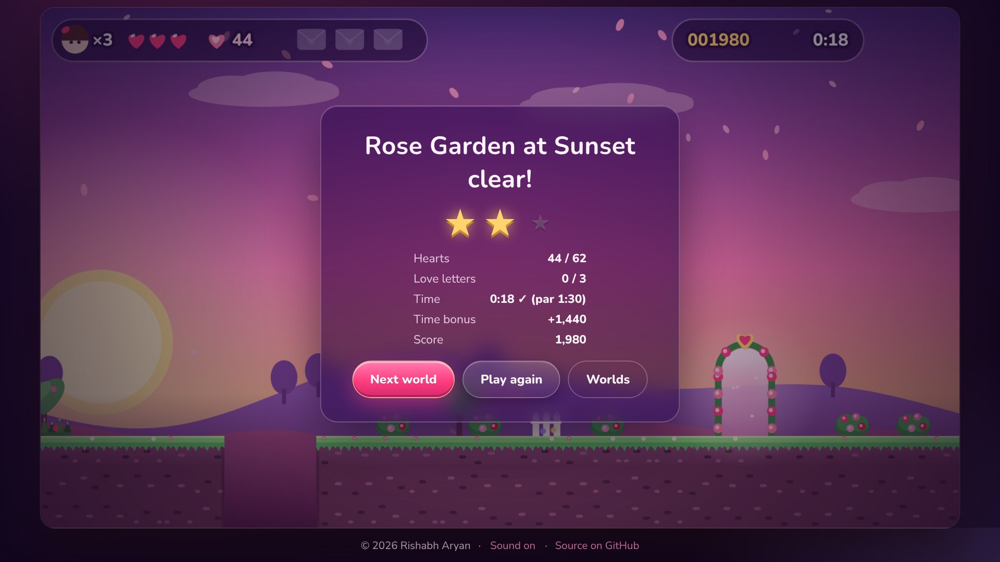 | 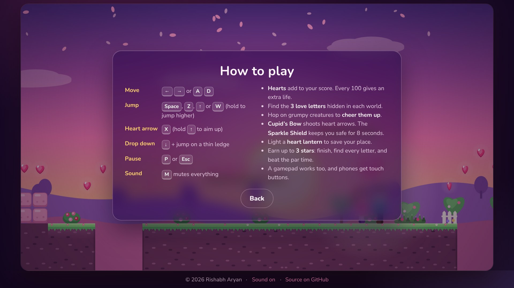 |

| Phone: title | Phone: touch controls | Phone: night city |
|---|---|---|
| 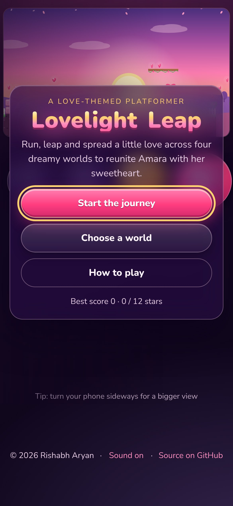 | 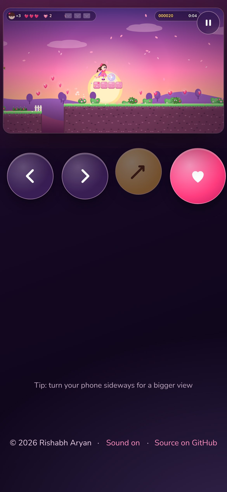 | 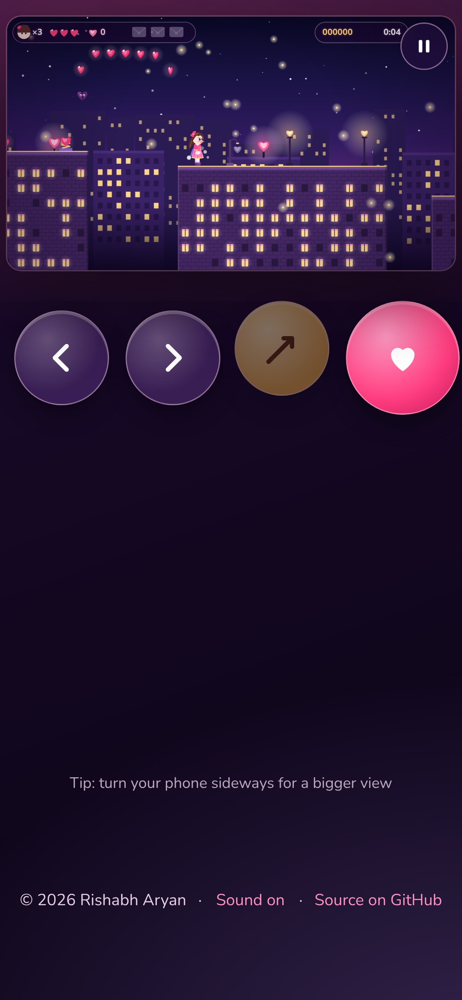 |

**Phone, landscape**

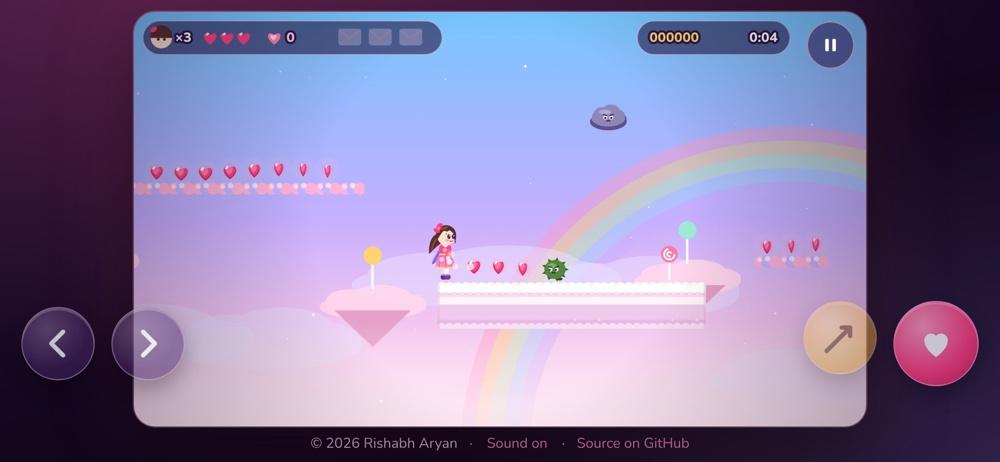

## 🚀 Run it locally

No install and no build: it's plain HTML, CSS and JavaScript.

```bash
git clone https://github.com/Rishabh-bgp/lovelight-leap.git
cd lovelight-leap
python3 -m http.server 8000
# open http://localhost:8000
```

Opening `index.html` directly from disk works as well.

### Tests

```bash
# 36 engine tests: physics, stomping, collectibles, power-ups, checkpoints,
# completion, save data, plus a solver that proves every world is beatable
node --test tests/

# 77 browser checks: keyboard, touch, pause, saving, game over, the boss and
# the ending at 1366px and 390px, with zero console errors (Playwright)
pip install playwright && python -m playwright install chromium
python tests/browser_test.py http://localhost:8000/index.html

# HTML validation
npx html-validate index.html
```

**How "beatable" is proven.** `tests/solver.js` runs a search over jump and run moves using the *real* game engine. For every world it finds a route to the goal and to each of the 3 letters, and the route is replayed to confirm it finishes under par. A scripted bot then plays the final world against King Grumblecloud with real enemies and no cheats until the reunion. The engine is fully deterministic, so the browser tests replay the same inputs in Chrome and reach the ending screen.

## 📊 Quality

| Check | Result |
|---|---|
| Engine tests (`node --test`) | ✅ 36 / 36 |
| Browser checks (Playwright, 1366px + 390px + landscape) | ✅ 77 / 77, 0 console errors |
| Accessibility (axe-core, WCAG 2.1 AA) | ✅ 0 violations |
| HTML (`html-validate:recommended`) | ✅ 0 problems |
| External requests | ✅ 0, everything is local |
| Lighthouse, desktop | 🟢 Performance **100** · Accessibility **100** · Best Practices **100** · SEO **100** (LCP 0.3 s, CLS 0, TBT 0 ms) |
| Lighthouse, mobile | 🟢 Performance **100** · Accessibility **100** · Best Practices **100** · SEO **100** (LCP 1.1 s, CLS 0, TBT 30 ms) |

## 📁 Project structure

```
lovelight-leap/
├── index.html            # Screens, HUD overlay, touch buttons
├── assets/
│   ├── css/style.css     # Glassy menus, responsive layout, touch layout
│   ├── img/favicon.svg
│   └── js/
│       ├── engine.js     # Pure game logic: physics, enemies, boss, scoring, save data
│       ├── levels.js     # The 4 worlds as text tile maps
│       ├── art.js        # Every sprite, tile and background, drawn in code
│       ├── audio.js      # Web Audio sound effects and chiptune sequencer
│       └── main.js       # Loop, input, camera, rendering, particles, menus
├── tests/
│   ├── engine.test.js    # Physics, combat, items, checkpoints, saves
│   ├── levels.test.js    # Map checks, solver, boss bot, no external URLs
│   ├── solver.js         # Reachability search on the real engine
│   ├── bots.js           # Boss-fight bot
│   ├── helpers.js
│   └── browser_test.py   # Playwright end-to-end checks
├── screenshots/
├── .nojekyll
└── LICENSE
```

## 🛠️ Tech

- **HTML5 Canvas 2D**: a 480×272 game view rendered into a back buffer at a whole-number scale (1× to 4×) for crisp art on every screen. Tiles are cached per theme, and the parallax layers are prerendered.
- **Vanilla JavaScript**: the engine is a pure, deterministic module (it runs the same in Node and the browser), stepped at a fixed 60 Hz with an accumulator.
- **Web Audio API**: square, triangle and noise voices make every sound effect, and a small step sequencer plays the three original songs.
- **CSS**: glassmorphism menus, `prefers-reduced-motion`, safe-area insets, and separate portrait and landscape touch layouts.
- **Gamepad API** and **Pointer Events** for controllers and multi-touch.
- **localStorage** for progress, best scores, stars and settings.
- Hosted on **GitHub Pages**.

## 👤 Author

**Rishabh Aryan** · [@Rishabh-bgp](https://github.com/Rishabh-bgp)

## 📄 License

[MIT](LICENSE) © 2026 Rishabh Aryan

## 🔗 Other repositories by Rishabh Aryan

| Repository | Description | Live |
|---|---|---|
| [100-days-of-python](https://github.com/Rishabh-bgp/100-days-of-python) | My original, offline, no-API-key solutions to all 100 projects of the 100 Days of Code Python bootcamp curriculum… | — |
| [Agentic-Engineering-Ebook](https://github.com/Rishabh-bgp/Agentic-Engineering-Ebook) | Agentic Engineering is a practical notebook-book on specifying, generating, verifying, and refining multi-tenant… | — |
| [beed-ml-study](https://github.com/Rishabh-bgp/beed-ml-study) | Provenance audit and leakage-aware benchmark of seizure-type classifiers on the Bangalore EEG Epilepsy Dataset — IIT… | — |
| [boston-house-price-prediction](https://github.com/Rishabh-bgp/boston-house-price-prediction) | Boston house price prediction with machine learning: scikit-learn gradient boosting, repeated K-fold CV, race… | [open](https://rishabh-bgp.github.io/boston-house-price-prediction/) |
| [Brain-Computer-Interfaces-and-Cognitive-Computing-An-Introduction](https://github.com/Rishabh-bgp/Brain-Computer-Interfaces-and-Cognitive-Computing-An-Introduction) | Brain–computer interfaces (BCIs) link neural activity to external devices, translating brain signals via algorithms… | — |
| [building-a-virtual-cell-in-python](https://github.com/Rishabh-bgp/building-a-virtual-cell-in-python) | A cell has a normal gene-activity pattern. Knock out one gene and that pattern changes. This project trains a small… | — |
| [california-house-price-prediction](https://github.com/Rishabh-bgp/california-house-price-prediction) | California house price prediction with machine learning: scikit-learn gradient boosting, repeated K-fold and spatial… | [open](https://rishabh-bgp.github.io/california-house-price-prediction/) |
| [Chronic-Kidney-Disease-Stage-Identification-in-HIV-Infected-Patients-Using-Supervised-ML](https://github.com/Rishabh-bgp/Chronic-Kidney-Disease-Stage-Identification-in-HIV-Infected-Patients-Using-Supervised-ML) | ML is transforming Chronic Kidney Disease (CKD) detection in HIV patients, catching early asymptomatic stages to… | — |
| [cobratate](https://github.com/Rishabh-bgp/cobratate) | Cobratate, an esoteric imperative programming language. Tate-flavored syntax, ordinary semantics, and a Python… | [open](https://rishabh-bgp.github.io/cobratate/) |
| [coda-synth](https://github.com/Rishabh-bgp/coda-synth) | CoDA-Synth: stylometric detection of LLM-rewritten dark-web documents with sparse TF-IDF + LinearSVC. Research lab,… | [open](https://shale-ember-delta-kite.grok.me/) |
| [IIT-ROPAR-GENAI-FOUNDATIONS](https://github.com/Rishabh-bgp/IIT-ROPAR-GENAI-FOUNDATIONS) | Free open-source Generative AI foundations ebooks (2026) covering Claude, Grok, Gemini, Cursor, OpenAI and more —… | — |
| [iris-classification](https://github.com/Rishabh-bgp/iris-classification) | Iris flower classification in Python: scikit-learn model comparison, tuning and evaluation, FastAPI /predict API,… | [open](https://rishabh-bgp.github.io/iris-classification/) |
| [kbc-game](https://github.com/Rishabh-bgp/kbc-game) | Kaun Banega Crorepati (KBC) quiz game for the terminal in Python: 16-question prize ladder, safe levels and 4… | — |
| [knn-classifier](https://github.com/Rishabh-bgp/knn-classifier) | Simple K-Nearest Neighbors classifier on the classic Iris dataset using scikit-learn. Loads data, trains the model,… | — |
| [linear-regression-model-](https://github.com/Rishabh-bgp/linear-regression-model-) | Supervised linear regression on the scikit-learn diabetes dataset. A single feature (BMI) is used to predict… | — |
| [logistic-regression](https://github.com/Rishabh-bgp/logistic-regression) | This graduate capstone applies multi-class logistic regression to the Iris dataset. It includes EDA, stratified… | — |
| [logistics-website-capstone](https://github.com/Rishabh-bgp/logistics-website-capstone) | Logistics website capstone: Kargonaut Logistics, a premium freight site mixing claymorphism, glassmorphism and… | [open](https://rishabh-bgp.github.io/logistics-website-capstone/) |
| [machine-learning-part-1](https://github.com/Rishabh-bgp/machine-learning-part-1) | Machine learning in Python with scikit-learn: heart disease classification and medical insurance cost regression… | — |
| [Meeting-of-Machines-Consumer-Agents-Seller-Agents-and-Hidden-Fulfilment-Risk-in-Online-Retail](https://github.com/Rishabh-bgp/Meeting-of-Machines-Consumer-Agents-Seller-Agents-and-Hidden-Fulfilment-Risk-in-Online-Retail) | Agentic commerce lets shopping and seller agents place orders without showing operational truth. This IS case argues… | — |
| [morocco-city-aware-load-forecasting](https://github.com/Rishabh-bgp/morocco-city-aware-load-forecasting) | City-aware short-term load forecasting and peak detection on high-resolution Moroccan smart-meter data (5 zones).… | — |
| [NIELIT-DATA-SCIENCE](https://github.com/Rishabh-bgp/NIELIT-DATA-SCIENCE) | Hands-on NumPy, Pandas, and Matplotlib Jupyter notebooks for the NIELIT Data Science curriculum — practical,… | — |
| [NIELIT-MACHINE-LEARNING-PROJECTS](https://github.com/Rishabh-bgp/NIELIT-MACHINE-LEARNING-PROJECTS) | Nineteen end-to-end machine learning projects: classification, regression, clustering, and recommendation, with… | — |
| [NIELIT-PYTHON-](https://github.com/Rishabh-bgp/NIELIT-PYTHON-) | Open-source Python teaching notebooks: a language reference and five capstone programs, with detailed documentation.… | — |
| [pan-cancer-classification](https://github.com/Rishabh-bgp/pan-cancer-classification) | Leakage, equivalence, conformal reliability and data efficiency on the UCI TCGA Pan-Cancer RNA-Seq dataset — IIT… | — |
| [Predicting-Hot-Events-in-the-Early-Period-through-Bayesian-Model-for-Social-Networks](https://github.com/Rishabh-bgp/Predicting-Hot-Events-in-the-Early-Period-through-Bayesian-Model-for-Social-Networks) | This notebook details the implementation and evaluation of a Bayesian perspective Early stage Event Prediction… | — |
| [prediction-as-power](https://github.com/Rishabh-bgp/prediction-as-power) | Laboratory and working paper on prediction as power in European electricity markets. A DE-like hourly simulator… | — |
| [real-estate-valuation-taiwan](https://github.com/Rishabh-bgp/real-estate-valuation-taiwan) | Taiwan real estate valuation (Xindian, New Taipei): house price per ping prediction with scikit-learn gradient… | [open](https://rishabh-bgp.github.io/real-estate-valuation-taiwan/) |
| [snakes-and-ladders](https://github.com/Rishabh-bgp/snakes-and-ladders) | 🐍🪜 Original Snakes & Ladders browser game: hand-drawn SVG snakes and ladders, 3D dice, 2-4 humans or bots, sound,… | [open](https://rishabh-bgp.github.io/snakes-and-ladders/) |
| [spam-scan](https://github.com/Rishabh-bgp/spam-scan) | Explainable spam, phishing & Indian-scam detector for SMS/email (English, Hindi, Hinglish): TF-IDF + Logistic… | [open](https://spam-scan.onrender.com) |
| [vedic-math-hybrid-kt](https://github.com/Rishabh-bgp/vedic-math-hybrid-kt) | Hybrid Vedic Math AI: rule-based sutras (Urdhva-Tiryagbhyam, Nikhilam, Yavadunam) plus RF classifier that cleans… | — |
| [wind-turbine-power-model](https://github.com/Rishabh-bgp/wind-turbine-power-model) | Single-turbine power curves + wind-farm simulation. Weibull wind stats, hourly NASA-style speed data, and… | — |
| [zoo-website-capstone](https://github.com/Rishabh-bgp/zoo-website-capstone) | Capstone project: a fictional zoo website built twice — a beginner-style simple version and a cinematic advanced… | [open](https://rishabh-bgp.github.io/zoo-website-capstone/) |
